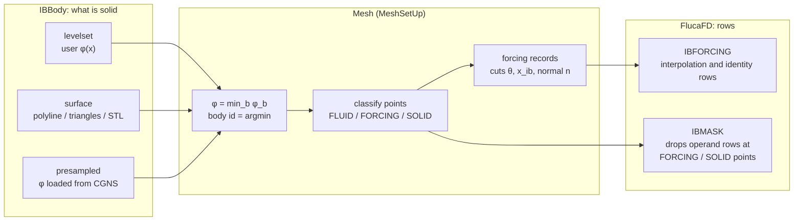
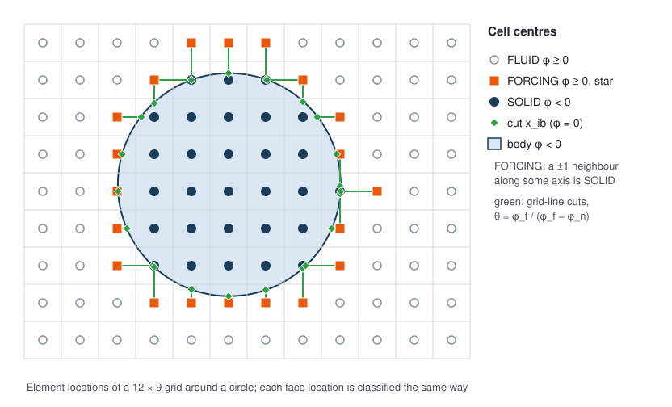
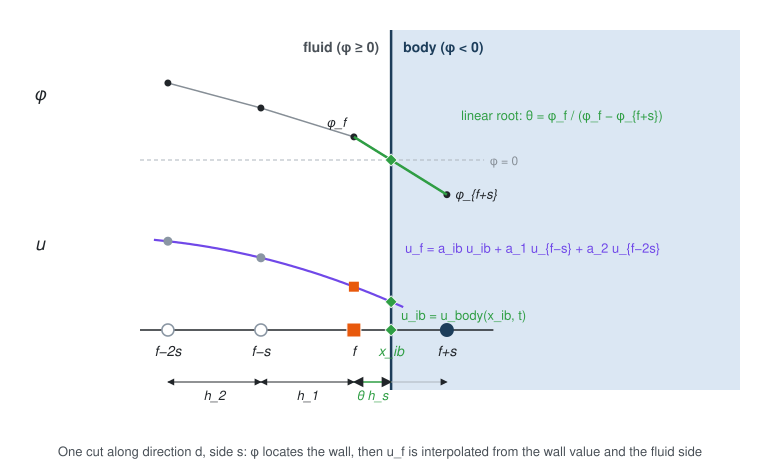
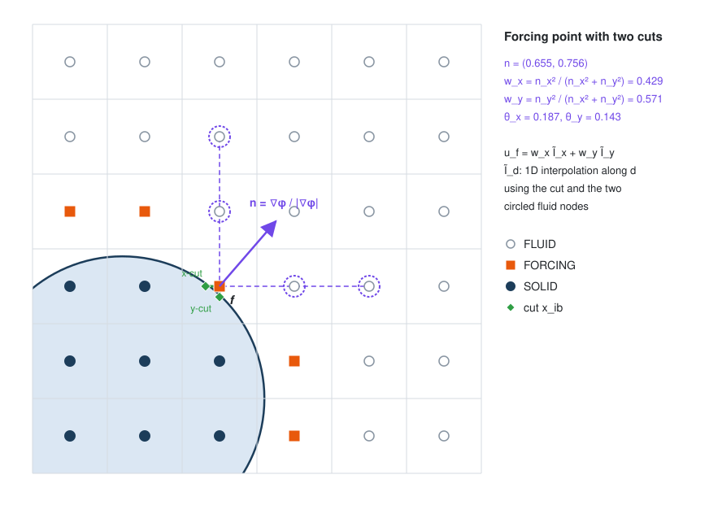
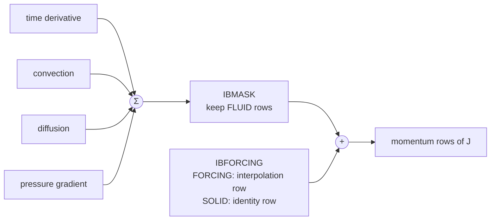

# Theory Guide

This document presents the theoretical foundations and numerical methods implemented in Fluca. It is intended for researchers and developers seeking to understand the mathematical formulation and numerical algorithms underlying the software.

## Table of Contents

- [Governing Equations](#governing-equations)
- [Grid System](#grid-system)
- [Temporal Discretization](#temporal-discretization)
- [Spatial Discretization](#spatial-discretization)
- [Immersed Boundary Method](#immersed-boundary-method)
- [Segregated Solvers](#segregated-solvers)

## Governing Equations

Fluca is designed to simulate unsteady incompressible viscous flow. Assuming constant density $\rho$, the governing equations consist of the continuity equation (mass conservation) and the Navier-Stokes equations (momentum conservation):

```math
\frac{\partial u_i}{\partial x_i} = 0 \tag{1}
```

```math
\frac{\partial u_i}{\partial t} + \frac{\partial}{\partial x_j} u_i u_j = -\frac{1}{\rho} \frac{\partial p}{\partial x_i} + \frac{\partial}{\partial x_j} \left( \nu \frac{\partial u_i}{\partial x_j} \right) \tag{2}
```

## Grid System

Fluca employs a non-staggered (collocated) grid system, in which all variables, including velocity components and pressure, are stored at cell centers. This arrangement offers several advantages over staggered grids: simplified implementation, more straightforward treatment of boundary conditions, and improved suitability for unstructured or hybrid grids. The collocated arrangement also facilitates extension to three-dimensional domains and complex geometries.

However, collocated grids are susceptible to the checkerboard (odd-even decoupling) instability, which manifests as spurious pressure oscillations in the solution. This phenomenon arises because the pressure gradient at a cell center, computed from neighboring cell-center pressures, is decoupled from the pressure at that cell itself, permitting non-physical pressure modes to persist. To address this issue, Fluca introduces a staggered face-normal velocity component that provides the necessary coupling between the pressure and velocity fields.

The face-normal velocity $U$ is defined as

```math
U = \mathbf{u}_\text{face} \cdot \mathbf{n}
```

where $\mathbf{u}_\text{face}$ denotes the velocity vector evaluated at the face center and $\mathbf{n}$ is the unit outward normal vector of the face. Since each face admits two possible normal directions, a consistent convention must be established. On Cartesian grids, Fluca adopts the convention that the face normal vector is oriented in the positive direction of the coordinate axis perpendicular to the face.

The face velocity is not obtained by simple linear interpolation from neighboring cell centers; rather, it is computed using the Rhie-Chow interpolation scheme, which incorporates a pressure-gradient correction term. This correction establishes proper coupling between the pressure and velocity fields, thereby suppressing the checkerboard instability while preserving the advantages of the collocated grid. The details of this interpolation are presented in the temporal discretization section.

## Temporal Discretization

### Navier-Stokes Equation

Fluca employs a second-order accurate time advancement scheme based on the method of Kim & Choi [1]. Second-order temporal accuracy is essential for minimizing numerical dissipation and dispersion errors, which is particularly important for resolving unsteady flow phenomena such as vortex shedding and transition to turbulence. The scheme is unconditionally stable and accommodates both explicit and implicit treatment of different terms.

The discretization begins by applying the Crank-Nicolson scheme to both the convective and viscous terms of the Navier-Stokes equation (2):

```math
\frac{u_i^{n+1} - u_i^n}{\Delta t} + \frac{1}{2} \frac{\partial}{\partial x_j} (u_i^{n+1} u_j^{n+1} + u_i^n u_j^n) = -\frac{1}{\rho} \frac{\partial p^{n+1/2}}{\partial x_i} + \frac{1}{2} \frac{\partial}{\partial x_j} \left( \nu^{n+1} \frac{\partial u_i^{n+1}}{\partial x_j} + \nu^n \frac{\partial u_i^n}{\partial x_j} \right) \tag{3}
```

Here, the pressure is evaluated at the half time step $n+1/2$, consistent with the time-centered nature of the scheme. The product $u_i^{n+1} u_j^{n+1}$ in the convective term introduces strong nonlinearity. To circumvent this difficulty, the convective term is linearized as follows:

```math
u_i^{n+1} u_j^{n+1} + u_i^n u_j^n = u_i^{n+1} u_j^n + u_i^n u_j^{n+1} + O(\Delta t^2) \tag{4}
```

This linearization preserves second-order accuracy in $\Delta t$. The linearized form permits direct solution without inner iterations when viscosity is constant. The resulting fully implicit time advancement scheme is:

```math
\frac{u^{n+1} - u^n}{\Delta t} + \frac{1}{2} \frac{\partial}{\partial x_j} (u_i^{n+1} u_j^n + u_i^n u_j^{n+1}) = -\frac{1}{\rho} \frac{\partial p^{n+1/2}}{\partial x_i} + \frac{1}{2} \frac{\partial}{\partial x_j} \left( \nu^{n+1} \frac{\partial u_i^{n+1}}{\partial x_j} + \nu^n \frac{\partial u_i^n}{\partial x_j} \right) \tag{5}
```

Rearranging to isolate known quantities from unknowns yields:

```math
u_i^{n+1} + \frac{\Delta t}{2} \frac{\partial}{\partial x_j} (u_i^{n+1} u_j^n + u_i^n u_j^{n+1}) - \frac{\Delta t}{2} \frac{\partial}{\partial x_j} \left( \nu^{n+1} \frac{\partial u_i^{n+1}}{\partial x_j} \right) + \frac{\Delta t}{\rho} \frac{\partial p'}{\partial x_i} = u_i^n + \frac{\Delta t}{2} \frac{\partial}{\partial x_j} \left( \nu^n \frac{\partial u_i^n}{\partial x_j} \right) - \frac{\Delta t}{\rho} \frac{\partial q}{\partial x_i} \tag{6}
```

Here, $p'=p^{n+1/2}-q$ denotes the pressure correction and $q$ represents a known pressure field from the previous step. Employing the pressure correction rather than the pressure itself as an unknown enhances accuracy when the governing equation operators are approximated in the solver, since $p'=O(\Delta t)$. The field $q$ is defined as the pressure at the previous half time step, $p^{n-1/2}$, except at the initial time step ($n=0$), where the initial pressure field $p^0$ is used.

The pressure field $p^{n+1}$ is obtained by extrapolation from the known values $p^{n+1/2}$ and $q$. Armfield & Street [3] demonstrated that this extrapolation preserves second-order temporal accuracy for the pressure field.

### Rhie-Chow Interpolation

Based on the temporal discretization presented above, the Rhie-Chow interpolation for the face velocity takes the form:

```math
\mathbf{u}_\text{face}^{n+1} = \overline{\mathbf{u}}^{n+1} + \frac{\Delta t}{\rho} \left[ \overline{\nabla p'} - \left. \nabla p' \right|_\text{face} \right] \tag{7}
```

where $\overline{\phi}$ denotes linear interpolation of $\phi$ from neighboring cell centers to the face. The first term $\overline{\mathbf{u}}^{n+1}$ represents the linear interpolation of cell-centered velocities. The second term is the correction, comprising the difference between the interpolated pressure gradient (from cell centers) and the pressure gradient computed directly at the face. This correction couples the pressure and velocity fields at the face, suppressing checkerboard oscillations.

The coefficient of the correction term is fixed as $\Delta t / \rho$, in contrast to the classical Rhie-Chow interpolation, which employs coefficients derived from the discretized momentum equation. This formulation follows Zang et al. [2], who developed a similar approach for collocated grids.

### Continuity Equation

The continuity equation (1) is enforced at the new time step $n+1$:

```math
\frac{\partial u_i^{n+1}}{\partial x_i} = 0 \tag{8}
```

## Spatial Discretization

### Cartesian Grid

Fluca employs the finite difference method (FDM) for spatial discretization on Cartesian grids. This approach is well-suited for structured grids, approximating spatial derivatives by finite differences of function values at discrete grid points.

As an illustrative example, consider the second derivative of a variable $\phi$ in the $x$-direction at cell $(i, j)$, assuming a two-dimensional configuration:

```math
\begin{aligned}
\left. \frac{\partial}{\partial x} \frac{\partial}{\partial x} \phi \right|_{i,j} & \approx \frac{\delta}{\delta x} \left( \frac{\delta}{\delta x} \phi_\text{cell} \right)_\text{face} \\
& = \frac{\left.\frac{\delta}{\delta x}\phi_\text{cell}\right|_{i+1/2,j} - \left.\frac{\delta}{\delta x}\phi_\text{cell}\right|_{i-1/2,j}}{\Delta x_{i-1/2,i+1/2}} \\
& = \frac{(\phi_{i+1,j} - \phi_{i,j}) / \Delta x_{i,i+1} - (\phi_{i,j} - \phi_{i-1,j}) / \Delta x_{i-1,i}}{\Delta x_{i-1/2,i+1/2}}
\end{aligned}
```

Here, $\delta$ denotes a finite difference operator, and subscripts indicate cell indices or face locations (half-integer indices denote face positions). This nested difference formulation ensures consistency with the control volume approach and provides second-order spatial accuracy on uniform grids. On non-uniform grids, second-order accuracy is preserved provided the grid stretching is sufficiently smooth. All spatial derivatives in the governing equations are discretized analogously.

When variable values are required at face locations, they are typically obtained by linear interpolation from neighboring cell centers. However, for the convective and continuity terms, Fluca employs the face-normal velocity $U$ computed via Rhie-Chow interpolation, which provides enhanced coupling between the pressure and velocity fields [1]:

```math
\frac{\partial}{\partial x_j} (u_i^{n+1} u_j^n + u_i^n u_j^{n+1}) \approx \frac{\delta}{\delta x_j} (\overline{u}_i^{n+1} U^n + \overline{u}_i^n \overline{u}_j^{n+1})
```

```math
\frac{\partial u_i^{n+1}}{\partial x_i} \approx \sum_i \frac{\delta U^{n+1}}{\delta x_i}
```

For a two-dimensional Cartesian grid, the discrete divergence of velocity at cell $(i, j)$ is:

```math
\left( \frac{\delta U}{\delta x} + \frac{\delta U}{\delta y} \right)_{i,j} = \frac{U_{i+1/2,j} - U_{i-1/2,j}}{\Delta x_{i-1/2,i+1/2}} + \frac{U_{i,j+1/2} - U_{i,j-1/2}}{\Delta y_{j-1/2,j+1/2}}
```

## Immersed Boundary Method

Fluca represents solid bodies on the Cartesian grid by the immersed boundary (IB) method: the grid does not conform to the body, and the no-slip condition on the body surface is imposed by modifying the discrete equations at grid points next to it. Fluca uses _direct forcing by row replacement along grid lines_ [6, 7, 8]. At each grid point next to the wall, the momentum equation is replaced by an interpolation equation that makes the velocity there consistent with the prescribed wall velocity. Inside the body, the momentum equation is replaced by the identity $u = u_\text{body}$. Each interpolation uses only points along one grid line through the forcing point, so every replaced row fits the star stencil of the underlying DMStag: the IB adds no unknowns and no nonzeros to the Jacobian.

The method proceeds in three stages, each owned by a different object:



### Level-Set Representation

Every body $b$ is described by a level-set function $\phi_b(\mathbf{x})$ that is negative inside the body and non-negative in the fluid. A body given as a function is evaluated directly; the user function needs only to be smooth with the correct sign, but an approximate signed distance ($|\nabla\phi| \approx 1$ near the wall) is recommended so that the wall normals are well defined. A body given as a closed surface (a polyline in 2D, a triangulation or STL file in 3D) is converted to a signed distance: the unsigned distance is computed exactly within a narrow band of three grid spacings and clamped outside it, and the sign comes from the parity of surface crossings along each grid line.

The level sets are sampled at every classified grid location: the cell centers and the face centers of each direction. Several bodies are combined into one field,

```math
\phi = \min_b \phi_b, \qquad \text{body}(\mathbf{x}) = \arg\min_b \phi_b(\mathbf{x}),
```

and after setup Fluca uses only $\phi$ and the body index; the original geometry is released. Because of this, the sampled $\phi$ is a complete description of the geometry as seen by the solver: `MeshView` stores it with the grid, and `MeshLoad` restores it as _presampled_ bodies, which carry only a wall velocity.

### Point Classification

Each grid point is classified from the signs of $\phi$ at the point itself and at its star neighbours (the points $\pm 1$ along each coordinate direction at the same location):

| Type | Condition | Equation at the point |
|------|-----------|-----------------------|
| SOLID | $\phi < 0$ | $u = u_\text{body}$ |
| FORCING | $\phi \ge 0$ and at least one star neighbour has $\phi < 0$ | interpolation along the cut grid lines |
| FLUID | otherwise | the momentum equation, unchanged |

Neighbours outside a non-periodic domain are ignored, since the domain boundary condition already applies there. Neighbours across a periodic boundary are taken from the periodic image, so classification does not depend on the domain decomposition.

<p align="center"></p>

### Wall Crossings

For a forcing point $f$ and a solid star neighbour $n = f + s\,\mathbf{e}_d$ ($s = \pm 1$), the wall crosses the grid line between them. Fluca locates the crossing by the linear root of $\phi$:

```math
\theta = \frac{\phi_f}{\phi_f - \phi_n} \in [0, 1), \qquad \mathbf{x}_\text{ib} = \mathbf{x}_f + \theta\,(\mathbf{x}_n - \mathbf{x}_f).
```

The crossing records the direction $d$, the side $s$, the fraction $\theta$, the body that owns $n$, and the point $\mathbf{x}_\text{ib}$ where the wall velocity is evaluated. The unit normal at the forcing point is computed from central differences of $\phi$ (one-sided at the domain edge). If $|\nabla\phi|$ vanishes, the normal falls back to the normalized sum of the cut directions, pointing into the fluid.

The linear root locates a straight wall exactly and a smooth curved wall to $O(h^2)$. Sharp corners are rounded within about one cell.

### Interpolation along a Grid Line

Along the cut direction $d$, the velocity at $f$ is interpolated from the wall value at the crossing and from the fluid nodes on the other side of $f$, as shown in the figure below.

<p align="center"></p>

Let $\delta = \theta h_s$ be the distance from $f$ to the crossing, $h_1$ the distance from $f$ to $f - s$, and $h_2$ the distance from $f - s$ to $f - 2s$. The Lagrange interpolant through these nodes, evaluated at $\mathbf{x}_f$, gives

```math
\tilde{I}_d = a_\text{ib}\, u_\text{body}(\mathbf{x}_\text{ib}, t) + a_1\, u_{f-s} + a_2\, u_{f-2s}.
```

With second-order (quadratic) interpolation, the default, the weights are

```math
a_\text{ib} = \frac{h_1 (h_1 + h_2)}{(\delta + h_1)(\delta + h_1 + h_2)}, \qquad
a_1 = \frac{\delta\,(h_1 + h_2)}{(\delta + h_1)\, h_2}, \qquad
a_2 = -\frac{\delta\, h_1}{(\delta + h_1 + h_2)\, h_2}.
```

With first-order (linear) interpolation, only the crossing and $f - s$ are used:

```math
a_\text{ib} = \frac{h_1}{\delta + h_1}, \qquad a_1 = \frac{\delta}{\delta + h_1}, \qquad a_2 = 0.
```

Because $f$ lies between the crossing and $f - s$, both are interpolations rather than extrapolations. The weights stay bounded as $\theta \to 0$ and reduce to $a_\text{ib} = 1$ when the wall passes through $f$. Unlike ghost-cell methods, the scheme needs no special treatment for small $\theta$.

A node is usable if it lies on the grid and is not SOLID. Quadratic interpolation falls back to linear for a direction where $f - 2s$ is not usable. A direction where $f - s$ is not usable is dropped, which includes a point that is cut on both sides along $d$. The order is selected with `-flucafd_ib_interpolation_order <1|2>`.

### Blending over Cut Directions

A forcing point can be cut along several directions, for example at a convex corner of the grid-line staircase. Fluca blends the one-dimensional interpolations of all usable directions, weighted by the squared components of the wall normal:

```math
u_f = \sum_d w_d\, \tilde{I}_d, \qquad w_d = \frac{n_d^2}{\sum_{d'} n_{d'}^2},
```

where the sum runs over the usable directions. Directions nearly parallel to the wall therefore contribute little. If $\sum n_d^2$ is negligible, equal weights are used.

<p align="center"></p>

If no direction is usable, for example when the only cut has its fluid side outside the domain, setup fails with the message that the grid is too coarse at the immersed boundary.

### Discrete Equations at IB Points

Let $\mathbf{P}_F$ be the diagonal matrix that selects FLUID rows, and let $\mathbf{B}$ be the matrix of IB rows: at a SOLID point $s$ its row is $u_s$, and at a FORCING point $f$ it is $u_f - \sum_d w_d (a_1 u_{f-s} + a_2 u_{f-2s})$. The wall values are known, so they go to the right-hand side as $\mathbf{b}_\text{ib}(t)$. A momentum equation $\mathbf{A}\mathbf{u} = \mathbf{r}$ then becomes

```math
\left[\mathbf{P}_F \mathbf{A} + \mathbf{B}\right] \mathbf{u} = \mathbf{P}_F \mathbf{r} + \mathbf{b}_\text{ib}(t).
```

These two pieces are the FlucaFD operator types `IBMASK` and `IBFORCING`. `IBMASK` wraps any operator and keeps its rows at FLUID points only ($\mathbf{P}_F \mathbf{A}$). `IBFORCING` produces $\mathbf{B}$, with the wall values as stencil entries that are evaluated at apply time, so a wall velocity $u_\text{body}(\mathbf{x}, t)$ may vary in time (for example a rotating cylinder). Masking the sum of all momentum terms and adding `IBFORCING` once guarantees that every IB row appears exactly once, however many operators contribute to the momentum equation:



The scheme has the following known limitations:

- A body thinner than the grid spacing that crosses no grid segment is not seen.
- An operator whose stencil is wider than one cell (a TVD upwind scheme reaching $i-2$) can read a SOLID point from a FLUID row. That point then holds $u_\text{body}$, as in classical direct forcing, and accuracy there is reduced to first order.

### Coupling with the Navier-Stokes Solver

The IB classification, the forcing records, and the IB operators are in place, but the NS solver does not use them yet. Coupling them into the system (12) also requires choosing:

- the pressure and continuity equations at SOLID and FORCING cells;
- the face-normal velocity $U$ and the Rhie-Chow correction (11) on faces next to the body;
- a mass-source correction for cells cut by the wall [7];
- the evaluation of body forces and torques.

## Segregated Solvers

### Matrix Form of the Discretized Governing Equations

To facilitate the development and analysis of solution algorithms, the discretized governing equations are expressed in matrix form using discrete operators. This representation elucidates the structure of the coupled system and enables rigorous analysis of solution methods.

The following discrete operators are defined. The operator $\mathbf{A}$ represents the implicit part of the momentum equation, comprising the identity (from the time derivative), the convective terms, and the viscous terms:

```math
(\mathbf{A}\mathbf{u}^{n+1})_i = u_i^{n+1} + \frac{\Delta t}{2} \frac{\delta}{\delta x_j} (\overline{u}_i^{n+1} U^n + \overline{u}_i^n \overline{u}_j^{n+1})  - \frac{\Delta t}{2} \frac{\delta}{\delta x_j} \left( \nu^{n+1} \frac{\delta u_i^{n+1}}{\delta x_j} \right)
```

The operator $\mathbf{G}$ represents the (scaled) cell-centered pressure gradient:

```math
(\mathbf{G}p)_i = \frac{\Delta t}{\rho} \frac{\delta p}{\delta x_i}
```

The operator $\mathbf{D}$ represents the discrete divergence operator applied to the face-normal velocities:

```math
\mathbf{D}U^{n+1} = \sum_i \frac{\delta U^{n+1}}{\delta x_i}
```

Using these operators, the discretized momentum equation (6) takes the compact form:

```math
\mathbf{A}\mathbf{u}^{n+1} + \mathbf{G}p' = u_i^n + \frac{\Delta t}{2} \frac{\delta}{\delta x_j} \left( \nu^n \frac{\delta u_i^n}{\delta x_j} \right) - \frac{\Delta t}{\rho} \frac{\delta q}{\delta x_i} \equiv \mathbf{r} \tag{9}
```

where $\mathbf{r}$ represents the right-hand side consisting of known quantities from the previous time step. The discretized continuity equation (8) becomes:

```math
\mathbf{D}U^{n+1} = 0 \tag{10}
```

To complete the operator notation, the Rhie-Chow interpolation is expressed using two additional operators. Let $\mathbf{T}$ denote the operator that linearly interpolates a cell-centered vector to the faces and extracts its normal component:

```math
\mathbf{T}\mathbf{v} = \overline{\mathbf{v}} \cdot \mathbf{n}
```

Let $\mathbf{G}^\text{st}$ denote the operator that computes the scaled face-normal pressure gradient directly at the face (the staggered gradient):

```math
\mathbf{G}^\text{st}p = \frac{\Delta t}{\rho} \left. \frac{\delta p}{\delta n} \right|_\text{face}
```

The Rhie-Chow interpolation (7) then takes the form:

```math
U^{n+1} = \mathbf{T}\mathbf{u}^{n+1} + \mathbf{T}\mathbf{G}p' - \mathbf{G}^\text{st}p' = \mathbf{T}\mathbf{u}^{n+1} + \mathbf{R}p' \tag{11}
```

where $\mathbf{R} = \mathbf{T}\mathbf{G} - \mathbf{G}^\text{st}$ represents the Rhie-Chow correction operator. Combining equations (9), (10), and (11) yields a fully coupled matrix system for the unknowns $\mathbf{u}^{n+1}$, $U^{n+1}$, and $p'$:

```math
\begin{bmatrix} \mathbf{A} & 0 & \mathbf{G} \\ -\mathbf{T} & \mathbf{I} & -\mathbf{R} \\ 0 & \mathbf{D} & 0 \end{bmatrix} \begin{bmatrix} \mathbf{u}^{n+1} \\ U^{n+1} \\ p' \end{bmatrix} = \begin{bmatrix} \mathbf{r} \\ 0 \\ 0 \end{bmatrix} \tag{12}
```

In practice, boundary conditions introduce additional constant terms in the right-hand side vector:

```math
\begin{bmatrix} \mathbf{A} & 0 & \mathbf{G} \\ -\mathbf{T} & \mathbf{I} & -\mathbf{R} \\ 0 & \mathbf{D} & 0 \end{bmatrix} \begin{bmatrix} \mathbf{u}^{n+1} \\ U^{n+1} \\ p' \end{bmatrix} = \begin{bmatrix} \mathbf{r} + \mathbf{b}_\text{mom} \\ b_\text{interp} \\ b_\text{cont} \end{bmatrix} \tag{13}
```

For non-constant viscosity, such as eddy viscosity dependent on the velocity field from a turbulence model, the matrix depends on the unknowns, necessitating iterative solution. Some formulations treat the Rhie-Chow correction term via _deferred correction_:

```math
\begin{bmatrix} \mathbf{A} & 0 & \mathbf{G} \\ -\mathbf{T} & \mathbf{I} & 0 \\ 0 & \mathbf{D} & 0 \end{bmatrix} \begin{bmatrix} \mathbf{u}^{n+1} \\ U^{n+1} \\ p' \end{bmatrix} = \begin{bmatrix} \mathbf{r} + \mathbf{b}_\text{mom} \\ \mathbf{R}p' + b_\text{interp} \\ b_\text{cont} \end{bmatrix}
```

This form requires iteration even for constant viscosity, but yields a simpler matrix structure.

The resulting systems are large, sparse, and possess saddle-point structure. Direct solution is computationally expensive. Fluca employs solution strategies based on approximate block factorization preconditioners.

### Approximate Block Factorization Preconditioners

Elman et al. [4] demonstrated that several classical solvers, including SIMPLE, can be formulated as stationary iterations:

```math
\mathbf{x}^{k+1} = \mathbf{x}^k + (\widetilde{\mathbf{M}}^k)^{-1} (\mathbf{f}^k - \mathbf{M}^k \mathbf{x}^k) \tag{14}
```

where $\widetilde{\mathbf{M}}$ is an approximation to the matrix $\mathbf{M}$. This is equivalent to one step of preconditioned Richardson iteration, with $\widetilde{\mathbf{M}}^{-1}$ serving as the preconditioner. For rapid convergence, $\widetilde{\mathbf{M}}$ must satisfy two conditions:

1. The approximation error $\mathbf{M} - \widetilde{\mathbf{M}}$ should be small.
2. The system $\widetilde{\mathbf{M}} \mathbf{y} = \mathbf{r}$ should be efficiently solvable.

Block factorizations of the original matrix provide natural candidates for such approximations.

Fluca employs the following decomposition to construct the approximation:

```math
\mathbf{M} =
\begin{bmatrix}
\mathbf{I} & 0 & 0 \\ 0 & \mathbf{I} & 0 \\ \mathbf{D}\mathbf{T}\mathbf{A}^{-1} & \mathbf{D} & \mathbf{I}
\end{bmatrix}
\begin{bmatrix}
\mathbf{A} & 0 & 0 \\ -\mathbf{T} & \mathbf{I} & 0 \\ 0 & 0 & \mathbf{S}
\end{bmatrix}
\begin{bmatrix}
\mathbf{I} & 0 & \mathbf{A}^{-1}\mathbf{G} \\ 0 & \mathbf{I} & \mathbf{T}\mathbf{A}^{-1}\mathbf{G} - \mathbf{R} \\ 0 & 0 & \mathbf{I}
\end{bmatrix} \tag{15}
```

This decomposition is derived from the LDU decomposition of $\mathbf{M}$ viewed as a $2 \times 2$ block matrix:

```math
\mathbf{M} =
\begin{bmatrix}
\mathbf{M}_{11} & \mathbf{M}_{12} \\ \mathbf{M}_{21} & \mathbf{M}_{22}
\end{bmatrix}
```

```math
\mathbf{M}_{11} =
\begin{bmatrix}
\mathbf{A} & 0 \\ -\mathbf{T} & \mathbf{I}
\end{bmatrix}
, \quad
\mathbf{M}_{12} =
\begin{bmatrix}
\mathbf{G} \\ -\mathbf{R}
\end{bmatrix}
, \quad
\mathbf{M}_{21} =
\begin{bmatrix}
0 & \mathbf{D}
\end{bmatrix}
, \quad
\mathbf{M}_{22} =
\begin{bmatrix}
0
\end{bmatrix}
```

where $\mathbf{S} = -\mathbf{D}\mathbf{T}\mathbf{A}^{-1}\mathbf{G}+\mathbf{D}\mathbf{R}$ denotes the Schur complement.

Fluca groups the lower triangular matrix and the diagonal matrix to form the following (LD)U decomposition:

```math
\mathbf{M} =
\begin{bmatrix}
\mathbf{A} & 0 & 0 \\ -\mathbf{T} & \mathbf{I} & 0 \\ 0 & \mathbf{D} & \mathbf{S}
\end{bmatrix}
\begin{bmatrix}
\mathbf{I} & 0 & \mathbf{A}^{-1}\mathbf{G} \\ 0 & \mathbf{I} & \mathbf{T}\mathbf{A}^{-1}\mathbf{G} - \mathbf{R} \\ 0 & 0 & \mathbf{I}
\end{bmatrix}
```

Let $\widetilde{\mathbf{A}}_1$ denote the approximation to $\mathbf{A}$ appearing in the Schur complement, and $\widetilde{\mathbf{A}}_2$ denote the approximation to $\mathbf{A}$ appearing in the upper triangular matrix. The approximate matrix $\widetilde{\mathbf{M}}$ is then:

```math
\widetilde{\mathbf{M}} =
\begin{bmatrix}
\mathbf{A} & 0 & 0 \\ -\mathbf{T} & \mathbf{I} & 0 \\ 0 & \mathbf{D} & \widetilde{\mathbf{S}}
\end{bmatrix}
\begin{bmatrix}
\mathbf{I} & 0 & \widetilde{\mathbf{A}}_2^{-1}\mathbf{G} \\ 0 & \mathbf{I} & \mathbf{T}\widetilde{\mathbf{A}}_2^{-1}\mathbf{G} - \mathbf{R} \\ 0 & 0 & \mathbf{I}
\end{bmatrix} \tag{16}
```

with the approximate Schur complement $\widetilde{\mathbf{S}}=-\mathbf{D}\mathbf{T}\widetilde{\mathbf{A}}_1^{-1}\mathbf{G}+\mathbf{D}\mathbf{R}$.

The error of this approximation is:

```math
\mathbf{E} = \mathbf{M} - \widetilde{\mathbf{M}} =
\begin{bmatrix}
0 & 0 & (\mathbf{I}-\mathbf{A}\widetilde{\mathbf{A}}_2^{-1})\mathbf{G} \\
0 & 0 & 0 \\
0 & 0 & \mathbf{D}\mathbf{T}(\widetilde{\mathbf{A}}_1^{-1}-\widetilde{\mathbf{A}}_2^{-1})\mathbf{G}
\end{bmatrix} \tag{17}
```

From this expression, it can be concluded that:

1. The momentum equation is unperturbed if $\widetilde{\mathbf{A}}_2 = \mathbf{A}$.
2. The Rhie-Chow interpolation is always unperturbed.
3. The continuity equation is unperturbed if $\widetilde{\mathbf{A}}_1 = \widetilde{\mathbf{A}}_2$.

The following sections describe how specific solvers construct the matrix decomposition and select $\widetilde{\mathbf{A}}_1$ and $\widetilde{\mathbf{A}}_2$ to satisfy these conditions.

### Fractional Step Method

Perot [5] demonstrated that the fractional step method (FSM) can be interpreted as an approximate block LU decomposition of the coupled matrix system. This perspective establishes the FSM as a member of the approximate block factorization preconditioner family.

Zang et al. [2] presented the FSM for collocated grids. Applied to the matrix system (13), the solution procedure consists of the following steps:

1. Solve $\mathbf{A}\mathbf{u}^* = \mathbf{r} + \mathbf{b}_\text{mom}$ for the intermediate velocity $\mathbf{u}^*$.
2. Compute the face-normal intermediate velocity: $U^* = \mathbf{T}\mathbf{u}^* + b_\text{interp}$.
3. Solve the pressure Poisson equation $\mathbf{D}\mathbf{G}^\text{st}p' = \mathbf{D}U^* + b_\text{cont}$ for $p'$.
4. Correct the velocity: $\mathbf{u}^{n+1} = \mathbf{u}^* - \mathbf{G}p'$.
5. Correct the face-normal velocity: $U^{n+1} = U^* - \mathbf{G}^\text{st}p'$.

The corresponding matrix decomposition is:

```math
\widetilde{\mathbf{M}} =
\begin{bmatrix}
\mathbf{A} & 0 & 0 \\ \mathbf{T} & -\mathbf{I} & 0 \\ 0 & \mathbf{D} & -\mathbf{D}\mathbf{G}^\text{st}
\end{bmatrix}
\begin{bmatrix} \mathbf{I} & 0 & \mathbf{G} \\ 0 & \mathbf{I} & \mathbf{G}^\text{st} \\ 0 & 0 & \mathbf{I}
\end{bmatrix} \tag{18}
```

This decomposition is easily invertible due to its simple approximate Schur complement $\widetilde{\mathbf{S}} = -\mathbf{D}\mathbf{G}^\text{st}$, which corresponds to a discrete Laplacian operator.

Comparing (18) with (16), the approximations to $\mathbf{A}$ are identified as:

```math
\widetilde{\mathbf{A}}_1 = \widetilde{\mathbf{A}}_2 = \mathbf{I} \tag{19}
```

The continuity equation remains unperturbed.

## References

1. D. Kim and H. Choi, A Second-Order Time-Accurate Finite Volume Method for Unsteady Incompressible Flow on Hybrid Unstructured Grids, _J. Comput. Phys._, 162, 411&ndash;428 (2000).
2. Y. Zang, R. L. Street, and J. R. Koseff, A non-staggered grid, fractional step method for time-dependent incompressible Navier–Stokes equations in curvilinear coordinates, _J. Comput. Phys._, 114, 18&ndash;33 (1994).
3. S. Armfield and R. Street, The pressure accuracy of fractional-step methods for the Navier-Stokes equations on staggered grids, _ANZIAM J._, 44, C20&ndash;C39 (2003).
4. H. Elman, V. E. Howle, J. Shadid, R. Shuttleworth, and R. Tuminaro, A taxonomy and comparison of parallel block multi-level preconditioners for the incompressible Navier–Stokes equations, _J. Comput. Phys._, 227, 1790&ndash;1808 (2008)
5. J. Perot, An analysis of the fractional step method, _J. Comput. Phys._, 108, 51&ndash;58 (1993).
6. J. Mohd-Yusof, Combined immersed-boundary/B-spline methods for simulations of flow in complex geometries, _Annual Research Briefs_, Center for Turbulence Research, 317&ndash;327 (1997).
7. J. Kim, D. Kim, and H. Choi, An immersed-boundary finite-volume method for simulations of flow in complex geometries, _J. Comput. Phys._, 171, 132&ndash;150 (2001).
8. E. A. Fadlun, R. Verzicco, P. Orlandi, and J. Mohd-Yusof, Combined immersed-boundary finite-difference methods for three-dimensional complex flow simulations, _J. Comput. Phys._, 161, 35&ndash;60 (2000).
